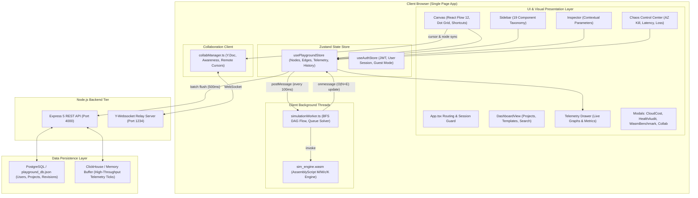

# System Design Playground — Comprehensive Project Condition & Architecture Map
**Branch:** `feature/nine-components`  
**Current Date/Timestamp:** October 11, 2026  
**Status:** All Core Milestones & 9-Component Extensions Implemented, Tested, and Verified  

---

## 1. Executive Summary & System Overview

**System Design Playground** is an interactive, browser-based distributed systems visual canvas, discrete-event traffic simulator, and chaos engineering studio. Designed with an n8n-inspired aesthetic and Apple VisionOS-grade spatial depth, it enables software engineers, SREs, and system architects to visually draft real-world architectures and simulate live traffic dynamics under mathematically rigorous queueing theory models ($M/M/c/K$, Jackson Networks, pull queues, serverless concurrency bursts, and WAF rate limits).

### Core Technological Pillars:
1. **Frontend Visual Canvas:** React 18 + TypeScript + Vite 6 + Tailwind CSS v4 + `@xyflow/react` (React Flow 12).
2. **Deterministic Dual Simulation Engine:**
   - **Web Worker Thread:** Runs continuous, non-blocking discrete-event simulation at 100ms intervals, offloading mathematical queue solving from the main UI thread.
   - **WebAssembly Engine:** Compiled AssemblyScript (`sim_engine.wasm`) executing zero-copy $M/M/c/K$ calculations with automated JavaScript fallback.
3. **State Management:** Reactive Zustand state store with atomic $O(N + E)$ hash-map reconciliation, undo/redo history stacks, and stateless LZ-String URL hash sharing.
4. **Real-Time Multiplayer Collaboration:** Standalone Node.js WebSocket relay (`server/collabServer.mjs`) driving Yjs CRDT room state and live peer cursor awareness.
5. **Dual-Mode Persistence & Analytics Tier:**
   - **Relational Storage:** Dual-mode PostgreSQL (`pg.Pool`) with automatic fallback to zero-config local JSON persistence (`server/data/playground_db.json`).
   - **High-Throughput Telemetry Engine:** Column-oriented ClickHouse client (`@clickhouse/client`) with in-memory sliding buffer fallback for p50/p90/p99 latency rollups.
   - **REST API:** Express 5 server (`server/apiServer.mjs`) featuring JWT authentication, rate-limiting with memory leak protection, IDOR isolation, and graph payload boundary controls.

---

## 2. Architecture & Data Flow Topology



---

## 3. Directory Structure & Codebase Mapping

```
SYSTEM DESIGN PLAYGROUND/
├── .planning/                              # GSD milestone specs, state tracking, and roadmaps
│   ├── PROJECT.md                          # Project definition & core value propositions
│   ├── STATE.md                            # Progress log and milestone lifecycle tracker
│   ├── REQUIREMENTS.md                     # Functional and non-functional requirements
│   ├── ROADMAP.md                          # Milestone 1-3 roadmap and execution phases
│   └── phases/                             # Phase-specific plan and verification artifacts
├── docs/                                   # Architectural specs, RFCs, and implementation plans
│   └── superpowers/
│       ├── plans/                          # 9-Component and SEO implementation plans
│       └── specs/                          # Math specifications and simulation algorithms
├── server/                                 # Backend REST & Collaboration Relay Services
│   ├── apiServer.mjs                       # Express 5 REST API, Auth, Rate Limiter, Telemetry
│   ├── collabServer.mjs                    # Standalone Yjs WebSocket collaboration relay
│   ├── data/
│   │   └── playground_db.json              # Local zero-config embedded relational database
│   ├── db/
│   │   ├── clickhouse.mjs                  # Column-oriented telemetry ingestion & rollups
│   │   └── postgres.mjs                    # PostgreSQL pool & local JSON atomic disk persistence
│   └── tests/                              # Node.js backend integration test suites
│       ├── authMiddleware.test.mjs         # JWT & optionalAuth verification (3 tests)
│       ├── collabServer.test.mjs           # WebSocket relay, heartbeat & eviction (2 tests)
│       ├── rateLimiterAndValidation.test.mjs # Rate limiter TTL & graph limits (4 tests)
│       └── tenantIsolation.test.mjs        # IDOR protection & tenant boundaries (3 tests)
├── src/                                    # Frontend Client Source Code
│   ├── api/
│   │   └── client.ts                       # Typed REST client with batch telemetry flushing
│   ├── collab/
│   │   ├── collabManager.ts                # Yjs document manager, awareness & graph sync
│   │   └── types.ts                        # Peer user and connection state definitions
│   ├── components/                         # React UI Components
│   │   ├── auth/
│   │   │   └── AuthScreen.tsx              # Glassmorphic Sign In, Sign Up, and Guest mode
│   │   ├── common/
│   │   │   ├── CookieConsentBanner.tsx     # GDPR-compliant cookie consent banner
│   │   │   └── NotFoundView.tsx            # 404 Route Not Found fallback screen
│   │   ├── dashboard/
│   │   │   └── DashboardView.tsx           # n8n-style Projects list, templates shelf, search
│   │   ├── edges/
│   │   │   └── FlowEdge.tsx                # Luminous white lines, particle flow & arrowheads
│   │   ├── icons/
│   │   │   ├── ComponentIcons.tsx          # SVG component icons for all 19 infrastructure types
│   │   │   └── DashboardLogos.tsx          # Brand logo and template illustration SVGs
│   │   ├── modals/                         # Feature Modals
│   │   │   ├── CloudCostModal.tsx          # Multi-cloud bill estimator (AWS vs GCP)
│   │   │   ├── CloudLibraryModal.tsx       # Cloud project save/load/fork modal & analytics
│   │   │   ├── CollabModal.tsx             # Room join/share and active peer roster modal
│   │   │   ├── ConfirmDeleteModal.tsx      # Safe destructive action confirmation
│   │   │   ├── CreateProjectModal.tsx      # Interactive template picker modal
│   │   │   ├── HealthAuditModal.tsx        # Deterministic SPOF linter with 1-click fix
│   │   │   ├── LegalModal.tsx              # Terms of Service & Privacy Policy modal
│   │   │   ├── ShareModal.tsx              # Stateless LZ-String URL hash sharing & export
│   │   │   └── WasmBenchmarkModal.tsx      # Interactive AssemblyScript vs JS benchmark
│   │   ├── nodes/
│   │   │   └── InfrastructureNode.tsx      # 4-sided omnidirectional node card with micro-anims
│   │   ├── Canvas.tsx                      # React Flow 12 canvas, shortcuts, drag-and-drop
│   │   ├── ChaosControlCenter.tsx          # AZ blackout, latency, and packet loss controls
│   │   ├── Header.tsx                      # Simulation controls, breadcrumbs, action toolbar
│   │   ├── Inspector.tsx                   # Right drawer contextual parameter inspector
│   │   ├── MultiplayerCursors.tsx          # Real-time remote cursor rendering
│   │   ├── Sidebar.tsx                     # Draggable 19-component palette drawer
│   │   └── TelemetryDrawer.tsx             # Bottom metrics graphs (Recharts) & ClickHouse stats
│   ├── config/
│   │   ├── components.ts                   # Metadata catalog for all 19 component types
│   │   └── presets.ts                      # Multi-AZ Web App, Flash Sale, and Kafka presets
│   ├── simulation/
│   │   ├── architectureLinter.ts           # 8 Deterministic resilience and SPOF audit rules
│   │   └── queueTheory.ts                  # Kendall M/M/c/K, pull queues, cold starts, Poisson
│   ├── store/
│   │   ├── useAuthStore.ts                 # User authentication, token lifecycle & guest session
│   │   └── usePlaygroundStore.ts           # Core playground state, worker listener, undo/redo
│   ├── types/
│   │   └── playground.ts                   # Core domain interfaces, components, and telemetry
│   ├── wasm/
│   │   ├── assembly/index.ts               # AssemblyScript queueing solver source
│   │   ├── build/sim_engine.wasm           # Compiled WebAssembly binary bytecode
│   │   ├── build/wasmBytecode.ts           # Base64 embedded WASM bytecode for instant load
│   │   └── wasmEngine.ts                   # Zero-copy WebAssembly instantiation bridge
│   ├── workers/
│   │   └── simulationWorker.ts             # Discrete-event DAG flow propagator Web Worker
│   ├── App.tsx                             # Top-level view router and deep linking controller
│   ├── index.css                           # Tailwind CSS v4 directives, VisionOS themes, anims
│   └── main.tsx                            # React 18 DOM mount point
├── tests/                                  # Root algorithmic test suite
│   └── simulationMath.test.ts              # 15 Mathematical queue & routing tests (100% pass)
├── package.json                            # Scripts, dependencies, and project metadata
└── tsconfig.json                           # TypeScript compiler configuration (strict mode)
```

---

## 4. Component Taxonomy & Domain Model (19 Components)

The canvas supports 19 distinct infrastructure primitives categorized into 5 architectural groups:

| Category | Component ID | Display Name | Mathematical / Simulation Behavior |
|:---|:---|:---|:---|
| **CLIENT** | `traffic_generator` | Traffic Generator | Source node generating dynamic load curves: Steady, Poisson ($Z_0\sqrt{\lambda}$), Flash Spike ($3.5\times$), or Diurnal ($24\text{h}$ sine). |
| **NETWORK** | `dns_router` | Global DNS Router | Routes ingress via Weighted Round-Robin (Canary/WRR) or Active-Passive health check failover. |
| **NETWORK** | `waf` | Web App Firewall | Enforces token-bucket rate limits ($R_{\text{limit}}$); drops excess traffic with HTTP 429 status. |
| **NETWORK** | `cdn` | CloudFront / Edge CDN | Absorbs static/cacheable reads ($85\%\text{--}95\%$ hit rate); forwards cache misses downstream. |
| **NETWORK** | `api_gateway` | API Gateway | Terminates SSL, checks JWT credentials, enforces rate limits, and routes to compute targets. |
| **NETWORK** | `load_balancer` | Load Balancer (ALB) | Distributes traffic via Round Robin, Least Connections, or IP Hash across healthy compute nodes. |
| **COMPUTE** | `web_server` | App Server (EC2/Pod) | Solves Kendall $M/M/c/K$ finite-buffer queueing; computes utilization $\rho$, latency, and drops. |
| **COMPUTE** | `serverless_function` | Serverless (Lambda) | Simulates concurrency bursts exceeding warm pool ($C_{\text{warm}}$), applying cold start delay penalty. |
| **COMPUTE** | `background_worker` | Background Worker | Pulls tasks from upstream message queues in configurable batch sizes up to processing capacity. |
| **STORAGE** | `cache` | Redis Cache Cluster | High-speed in-memory store; simulates configurable hit rate ($0\%\text{--}100\%$) and LRU/LFU/TTL eviction. |
| **STORAGE** | `relational_db` | PostgreSQL Database | ACID relational store; models Read/Write ratio splitting, connection pooling, and replication lag. |
| **STORAGE** | `nosql_db` | NoSQL Document DB | Horizontally scalable document store optimized for high-throughput write streams. |
| **STORAGE** | `search_engine` | Elasticsearch / Search | Query indexer; calculates search query latency penalties under heavy indexing batch load. |
| **STORAGE** | `analytics_db` | Columnar Analytics DB | Analytical warehouse (ClickHouse/Snowflake archetype) optimized for aggregate analytical queries. |
| **STORAGE** | `object_storage` | S3 / Object Storage | Durable unstructured blob store for assets, media, and long-term event archives. |
| **MESSAGING** | `message_queue` | Kafka Cluster | High-throughput distributed streaming log with backpressure buffer and partition retention. |
| **MESSAGING** | `standard_queue` | SQS Standard Queue | Pull-based task queue; models buffer backlog accumulation and worker draining mechanics. |
| **MESSAGING** | `pub_sub` | Pub/Sub Topic | Asynchronous $1\text{-to-}N$ event fan-out broadcaster; replicates $100\%$ outflow to all connected subscribers. |
| **NETWORK** | `external_api` | 3rd-Party External API | External partner endpoint; models third-party timeout thresholds and unreliability chaos drops. |

---

## 5. Mathematical & Simulation Engine Mechanics

The discrete-event simulation engine executes inside a dedicated Web Worker (`src/workers/simulationWorker.ts`) every 100ms.

### 5.1 Kendall $M/M/c/K$ Finite Queue Solver
For compute instances with $c$ parallel servers, service rate $\mu$, arrival rate $\lambda$, and max buffer $K$:
$$\rho = \frac{\lambda}{c \cdot \mu}$$
- **Saturated Regime ($\rho > 1.0$):**
  $$P_{\text{drop}} = \min\left(0.95, \frac{\lambda - c\cdot\mu}{\lambda}\right)$$
  $$\text{ProcessedRps} = c \cdot \mu, \quad \text{DroppedRps} = \lambda - \text{ProcessedRps}$$
- **Queue Latency Formula (Pollaczek–Khinchine / Kendall):**
  $$W_q = \frac{\rho}{c\mu(1 - \rho)}$$
  $$\text{EffectiveLatency} = \text{BaseLatency} + \min(5000, W_q \cdot 1000) + \text{InjectedLatency}$$

### 5.2 Pull-Based Queue Draining
For task queues with backlog $B$, ingress rate $\lambda$, and downstream worker capacity $C_{\text{worker}}$:
$$\text{OfferedTasks} = B + \lambda$$
$$\text{DrainedRps} = \min(C_{\text{worker}}, \text{OfferedTasks})$$
$$\text{TentativeBacklog} = \text{OfferedTasks} - \text{DrainedRps}$$
$$\text{DroppedOverflow} = \max(0, \text{TentativeBacklog} - K)$$
$$\text{RemainingBacklog} = \min(K, \text{TentativeBacklog})$$

### 5.3 Serverless Cold Start Burst Dynamics
When arrival rate $\lambda$ exceeds warm container capacity $C_{\text{warm}}$:
$$\text{ColdRatio} = \frac{\lambda - C_{\text{warm}}}{\lambda}$$
$$\text{Latency} = \text{BaseLatency} + (\text{ColdRatio} \times \text{ColdStartPenaltyMs})$$

### 5.4 WAF Rate Limiting
$$\text{Dropped}_{429} = \max(0, \lambda - R_{\text{limit}})$$
$$\text{ProcessedRps} = \lambda - \text{Dropped}_{429}$$

### 5.5 Ingress Flow Routing
- **Weighted Round Robin (WRR / Canary):** Outgoing flow on edge $i$ with weight $W_i$:
  $$\text{Flow}_i = \lambda \times \frac{W_i}{\sum_j W_j}$$
  Includes residual integer conservation to guarantee zero lost packets.
- **Failover:** If primary target is healthy, routes $100\%$ to primary; if primary is dead (or killed by chaos blackout), fails over $100\%$ to secondary target.
- **Pub/Sub Fan-Out:** For $N$ subscriber edges, each edge receives $100\%$ of outflow ($\text{EdgeFlow}_i = \text{Outflow}$).

---

## 6. Visual Presentation & UX Architecture

1. **4-Sided Omnidirectional Connection Ports:**
   Every node card in [`InfrastructureNode.tsx`](file:///c:/Users/babbe/OneDrive/Desktop/study/SYSTEM%20DESIGN%20PLAYGROUND/src/components/nodes/InfrastructureNode.tsx#L292-L328) exposes 4 cardinal connection ports (`top`, `bottom`, `left`, `right`). Uses `ConnectionMode.Loose` in React Flow, enabling flexible bidirectional diagramming from any edge of a component.
2. **Luminous Directional Flow Edges:**
   Edges in [`FlowEdge.tsx`](file:///c:/Users/babbe/OneDrive/Desktop/study/SYSTEM%20DESIGN%20PLAYGROUND/src/components/edges/FlowEdge.tsx) render crisp white paths in dark mode (`#ffffff`) with subtle specular glow, integrated SVG directional arrowheads, role-specific particle animation speeds (memory cache is ultra-fast; disk DB is deliberate), and error-rate color coding (amber for heavy load, red for packet drops).
3. **n8n Quick-Add (+) Button:**
   Clicking the (+) badge to the right of any node opens a contextual quick-add popover allowing 1-click downstream node attachment and automatic wire generation.
4. **Keyboard Command Deck:**
   Full desktop keyboard shortcut support: `Ctrl+Z` (Undo), `Ctrl+Y` (Redo), `Ctrl+C` (Copy), `Ctrl+V` (Paste), `Ctrl+D` (Duplicate), `Delete/Backspace` (Delete node/edge), `Space` (Play/Pause simulation), `Ctrl+=` (Zoom in), `Ctrl+-` (Zoom out), `Ctrl+0` (Fit view), and `?` (Shortcuts cheat sheet).
5. **Deterministic Resilience Linter:**
   [`architectureLinter.ts`](file:///c:/Users/babbe/OneDrive/Desktop/study/SYSTEM%20DESIGN%20PLAYGROUND/src/simulation/architectureLinter.ts) evaluates 8 deterministic rules (Database SPOF, Compute SPOF, Uncached DB, Single-target LB, Missing Queue Backpressure, Single-AZ exposure, Overutilized nodes). Produces a letter grade (A through F) with 1-click auto-remediation in [`HealthAuditModal.tsx`](file:///c:/Users/babbe/OneDrive/Desktop/study/SYSTEM%20DESIGN%20PLAYGROUND/src/components/modals/HealthAuditModal.tsx).
6. **Multi-Cloud Bill Estimator:**
   [`CloudCostModal.tsx`](file:///c:/Users/babbe/OneDrive/Desktop/study/SYSTEM%20DESIGN%20PLAYGROUND/src/components/modals/CloudCostModal.tsx) calculates itemized monthly infrastructure expenditure across AWS and GCP, broken down by Compute, Storage, and Network, with a 1-year Reserved Instance discount toggle.

---

## 7. State Management & Web Worker Synchronization

### Worker Tick Reconciliation ($O(N + E)$):
On every 100ms simulation tick, [`usePlaygroundStore.ts`](file:///c:/Users/babbe/OneDrive/Desktop/study/SYSTEM%20DESIGN%20PLAYGROUND/src/store/usePlaygroundStore.ts#L245-L302) consumes worker updates via `simWorker.onmessage`:
- Pre-indexes `updatedNodes` and `updatedEdges` into native `Map` instances (`nodeUpdateMap`, `edgeUpdateMap`).
- Performs $O(1)$ lookups during state array mapping.
- Only updates Zustand state references if numeric metrics (`currentRps`, `currentQueue`, `currentLatency`, `status`) actually diverged, preventing redundant React re-renders.

### High-Throughput Telemetry Streaming:
Every tick, `apiClient.bufferTelemetryTick()` enqueues metrics into an in-memory batch. Every 500ms, the buffer flushes via `POST /api/telemetry/ingest` to ClickHouse (or the server memory store), keeping client network overhead minimal.

---

## 8. Backend Infrastructure & Security Audit

### 8.1 API Server ([`server/apiServer.mjs`](file:///c:/Users/babbe/OneDrive/Desktop/study/SYSTEM%20DESIGN%20PLAYGROUND/server/apiServer.mjs))
- **Port:** 4000 (proxied via Vite at `/api`).
- **Security Headers:** Strict-Transport-Security (`HSTS: max-age=31536000`), CORS whitelist with development localhost regex.
- **Authentication:** Dual-mode JWT authentication supporting registered users (`bcryptjs` password hashing) and frictionless Guest sessions (`isGuest: true`).
- **Rate Limiting:** `authRateLimiter` restricts authentication attempts to 15 requests per 15-minute window with automated active TTL sweeping to prevent heap leaks.
- **Graph Ingestion Protection:** `POST /api/architectures` enforces upper bounds `MAX_GRAPH_NODES = 1000` and `MAX_GRAPH_EDGES = 2000`, defending against payload memory exhaustion.
- **Multi-Tenant Isolation:** All database updates and deletes enforce `userId` ownership checks, preventing Insecure Direct Object References (IDOR).

### 8.2 Collaboration Relay ([`server/collabServer.mjs`](file:///c:/Users/babbe/OneDrive/Desktop/study/SYSTEM%20DESIGN%20PLAYGROUND/server/collabServer.mjs))
- **Port:** 1234 (WebSocket `ws://localhost:1234`).
- **Engine:** `y-websocket` server with Yjs document state sharing.
- **Room Lifecycle:** Rooms auto-evict from server memory after all peers disconnect and an idle timeout elapses, avoiding memory creep.

---

## 9. Test Suite Verification & Quality Metrics

The project is backed by two automated test suites covering mathematics, security, and tenant isolation:

### Test Execution Summary:
| Test Suite | File Location | Tests | Status | Duration |
|:---|:---|:---:|:---:|:---:|
| **Simulation Math & Flow** | [`tests/simulationMath.test.ts`](file:///c:/Users/babbe/OneDrive/Desktop/study/SYSTEM%20DESIGN%20PLAYGROUND/tests/simulationMath.test.ts) | 15 | Passed (100%) | 29 ms |
| **Auth Middleware & JWT** | [`server/tests/authMiddleware.test.mjs`](file:///c:/Users/babbe/OneDrive/Desktop/study/SYSTEM%20DESIGN%20PLAYGROUND/server/tests/authMiddleware.test.mjs) | 3 | Passed (100%) | 568 ms |
| **Collab Relay & Memory** | [`server/tests/collabServer.test.mjs`](file:///c:/Users/babbe/OneDrive/Desktop/study/SYSTEM%20DESIGN%20PLAYGROUND/server/tests/collabServer.test.mjs) | 2 | Passed (100%) | 664 ms |
| **Rate Limiter & Graph Limits**| [`server/tests/rateLimiterAndValidation.test.mjs`](file:///c:/Users/babbe/OneDrive/Desktop/study/SYSTEM%20DESIGN%20PLAYGROUND/server/tests/rateLimiterAndValidation.test.mjs) | 4 | Passed (100%) | 618 ms |
| **Tenant Isolation & IDOR** | [`server/tests/tenantIsolation.test.mjs`](file:///c:/Users/babbe/OneDrive/Desktop/study/SYSTEM%20DESIGN%20PLAYGROUND/server/tests/tenantIsolation.test.mjs) | 3 | Passed (100%) | 65 ms |
| **TypeScript Typecheck** | `npm run lint` (`tsc --noEmit`) | Entire App | Passed (0 errors) | ~3 s |

**Total Automated Tests:** 27 test cases across 5 test suites. **Pass Rate:** 100%.

---

## 10. Current Operational Status & Recommended Next Steps

### Operational Status:
- Dev Vite server running smoothly at `http://localhost:3000/`.
- Express API server running at `http://localhost:4000/`.
- Collaboration WebSocket server running at `ws://localhost:1234/`.
- Working tree is clean on branch `feature/nine-components`.

### Recommended Roadmap Opportunities (Non-Breaking):
1. **Store Modularization:** Decompose `usePlaygroundStore.ts` into focused domain slices (`useCanvasSlice`, `useSimulationSlice`, `useModalSlice`) using Zustand's `StateCreator` pattern to enhance readability.
2. **Docker Compose Orchestration:** Package the Express API, Collab WebSocket server, PostgreSQL, ClickHouse, and Vite frontend into a single `docker-compose.yml` for unified one-command deployment.
3. **Preset Catalog Expansion:** Add additional starter architectural presets showcasing the 9 new components (e.g., Serverless Event-Driven Microservices, Global Multi-Region Active-Active with WAF & DNS Failover).
